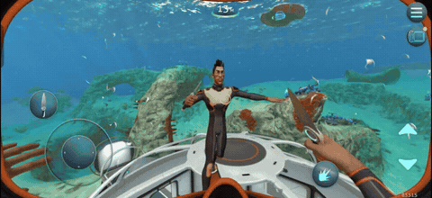

  <h1>Subnautica Android Multiplayer</h1>
  
<strong>Co-op for Subnautica on Android</strong>

  
Two players on the same network, sharing a world and building a base together.

  

    <a href="https://github.com/zerk235/subnautica-android-multiplayer/releases/download/v0.3.13-installer-fix-test/snmp-installer-fix-test.apk"><strong>Download APK for Android</strong></a> ·
    <a href="https://github.com/zerk235/subnautica-android-multiplayer/releases/tag/v0.3.13-installer-fix-test">Release notes and SHA-256</a> ·
    <a href="README.md">Русский</a>
  

  

## Quick start

| Android | Game version | Connection |
| --- | --- | --- |
| 10+ · ARM64 | Subnautica **1.22.83315** | 2 players · same Wi-Fi network or hotspot |

**Public demo 0.3.13** includes an in-game lobby and fixes for Shizuku access, world restoration and diagnostics. Both phones need the same mod build on protocol **45**.

1. **Install the patcher.** Download the APK above. Save your game and return to the main menu. In the patcher, select **Prepare game** and then **Install prepared mod**.
2. **Create a room.** Connect both phones to the same network. Open **Совместная игра** (Multiplayer) in the game menu. The host creates a room, the guest selects it, and both players press **Готов** (Ready).
3. **Open a world.** The host opens and saves their world. The mod transfers the save and loads it for the guest.

[Installation](docs/INSTALLER.md) · [Joining a room](docs/PLAYING.md) · [Compatibility](docs/COMPATIBILITY.md) · [Diagnostics](docs/DIAGNOSTICS.md)

## What you can do together

| Feature | Available in the demo |
| --- | --- |
| **Join a friend** | Local room discovery, lobby and ready status in the main menu. Either phone can host without root. |
| **Load the host's world** | Supported save transfer including `CellsCache`, guest autoload and rejoining. |
| **See your teammate** | Remote player model and a marker with a label and distance. Includes head visibility, indoor lighting and Builder grip fixes. |
| **Build a base** | Construction and deconstruction of supported corridors, hatches, windows, foundations, ladders, reinforcements, rooms and domes. |
| **Share resources** | Floor Locker with two-way item transfers, verified battery charge and persistent contents. [Details](docs/LOCKER_CONTENTS.md) |

<strong>Installation, signing and backups</strong>

You need your own installed copy of Subnautica and its resources. The patcher runs on the phone without a PC or root. The installer APK is distributed separately from the game.

If the signing certificate matches, update the installer in place and keep its app data. It stores the local signing key and backups. Preparing the mod creates a separate copy of the APKs and resources, then patches, signs and verifies them.

For a first signing-key change, connect Shizuku and make a verified world backup before replacing the game. Android shows a system prompt for removal. Then install the prepared mod and restore your worlds. The backup excludes private game preferences under `/data/user/...`.

The installer includes Shizuku help and the verified GT8 workaround for the limited-ADB warning. [Installer guide](docs/INSTALLER.md) · [Backups and Shizuku](docs/INSTALLER_BACKUPS.md) · [Previous demo, protocol 37](https://github.com/zerk235/subnautica-android-multiplayer/releases/tag/v0.3.13-installer-preview)

<strong>Demo limitations</strong>

- The public build supports two phones on the same local network.
- New standalone bases were tested with foundations and multipurpose rooms. Other types and more complex combinations are still being tested.
- Selected fish and Stalker sync is experimental. Vehicle, animation, personal inventory and ecosystem sync is partial.
- Recovery from an interrupted Locker transfer and a full play test of changing worlds without restarting are still in progress.

[Compatibility matrix](docs/COMPATIBILITY.md) · [Demo roadmap](docs/ROADMAP.md)

## Development

| Directory | Contents |
| --- | --- |
| [`modloader/`](modloader/) | C++17 native mod and ShadowHook |
| [`installer/`](installer/) | Android installer |
| [`tests/`](tests/) | Save transfer, autoload, building and avatar tests |
| [`tools/`](tools/) | Builds, desktop APK patching and test tools |

[Build instructions](docs/BUILDING.md) · [Contributing](CONTRIBUTING.md) · [Project license](LICENSE.md) · [Third-party licenses](THIRD_PARTY_NOTICES.md)

The desktop patcher creates an unsigned APK from your local copy of the game. Game APKs, libraries, assets, saves and signing keys are kept outside the repository. Project-owned code currently has no open-source license.

An unofficial community project by [zerk235](https://github.com/zerk235). Subnautica and its assets belong to their respective owners.
