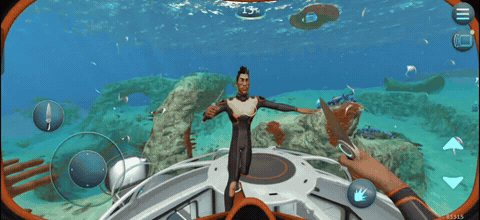

# Subnautica Android Multiplayer

**Экспериментальный LAN-кооп для Subnautica на Android.** Два игрока в одной сети, автоматическая передача сохранённого мира и совместное строительство поддерживаемых деталей базы.

[English](README.en.md) · [Установщик Android](docs/INSTALLER.md) · [Диагностика](docs/DIAGNOSTICS.md) · [Как играть](docs/PLAYING.md) · [Что работает](docs/COMPATIBILITY.md) · [Сборка](docs/BUILDING.md) · [План демо](docs/ROADMAP.md)

> **Публичная демоверсия 0.3.5.** Играйте вдвоём по локальной сети: выбирайте хоста на любом из двух телефонов, автоматически получайте его сохранённый мир, стройте и разбирайте поддерживаемые детали базы. Теперь можно обмениваться предметами через обычный напольный шкаф — проверены переносы в обе стороны, заряд батарейки и содержимое шкафа после перезапуска. Установка выполняется на Android без компьютера и root. Мод продолжает развиваться: [проверенные возможности и ограничения](docs/COMPATIBILITY.md). Для первых проб используйте отдельный мир и резервные копии.

## 🎮 Multiplayer Gameplay



## Скачать и установить

**[Скачать установщик 0.3.5 — APK](https://github.com/zerk235/subnautica-android-multiplayer/releases/download/v0.3.5-installer-preview/snmp-installer-preview.apk)** · [Страница релиза и контрольная сумма](https://github.com/zerk235/subnautica-android-multiplayer/releases/tag/v0.3.5-installer-preview)

**0.3.5 добавляет общее содержимое обычного напольного шкафа.** Проверены
переносы ресурсов в обе стороны, точное количество, заряд батарейки 57% → 57%
и сохранение трёх предметов после полного перезапуска обеих игр.
[Описание обновления и ограничения](docs/releases/0.3.5-installer-preview.md).

Обновите установщик поверх прежнего, затем обновите мод **на обоих телефонах**:
сохранитесь, выйдите в меню → **«Подготовить мод» → «Установить подготовленный мод»**.
Одного обновления установщика недостаточно. Сохраняйте его данные и ключ.
Текущий протокол — **28**, у обоих игроков должна быть одинаковая сборка мода.
Автоматическое восстановление переноса после аварийного завершения процесса
ещё не реализовано; используйте отдельный тестовый мир и обычные ресурсы.
[Содержимое шкафа](docs/LOCKER_CONTENTS.md) · [Диагностика](docs/DIAGNOSTICS.md).

**В версии 0.3:** добавлены кнопки **«Запустить хостом»** и **«Подключиться гостем»**.
Хостом может быть телефон без root, в том числе с миром, полученным от другого
хоста. Исправлен автоматический вход при смене ролей с сохранением исходной копии мира.
Если обновляетесь со старой 0.2, обновите само приложение
SN Multiplayer Installer поверх прежнего, затем сохранитесь, выйдите в меню игры
и выполните **«Подготовить мод» → «Установить подготовленный мод»** на обоих
телефонах. Данные установщика сохраняйте: в них находится ключ обновлений.
Для текущего выпуска на обоих телефонах нужен протокол **28** и одинаковая сборка;
старые публичные протоколы **23**, **25** и **27** с ним несовместимы.
[История выбора роли в 0.3](docs/releases/0.3.0-installer-preview.md).

Нужны Android 10+, ARM64 и собственная установленная Subnautica **1.22.83315**
со всеми ресурсами. Установка мода выполняется на телефоне без компьютера и root.
APK установщика не содержит игру и не скачивает её.

**Что делает «Подготовить мод»:** создаёт отдельную подготовленную копию APK
игры и необходимых ресурсов в папке **SN Multiplayer Installer**, добавляет мод,
подписывает и проверяет файлы. Эта кнопка ещё не устанавливает мод и не удаляет
игру. **При первой смене подписи и разрешённом Shizuku после APK также создаётся
копия миров.** Без Shizuku подготовка APK возможна, а копирование миров недоступно.
Приватные настройки игры из `/data/user/...` не копируются.

При первой смене подписи: **«Подключить Shizuku» → «Создать копию миров» →
«Подготовить мод» → «Удалить старую игру» → «Установить подготовленный мод» →
«Восстановить миры».** Удаление подтверждается в отдельном окне Android после
проверки APK и совпадения текущих миров с копией. Установщик не подтверждает его
за вас. APK и копия миров останутся в отдельном приложении после удаления игры.
Архив можно дополнительно экспортировать в выбранную папку.

Для доступа к мирам на Android 11+ Shizuku запускается через беспроводную
отладку на самом телефоне. В приложении есть **«Помощь с Shizuku»**, включая
ошибку «Доступ к ADB ограничен» на realme / OPPO / OnePlus и найденный на GT8
способ показать скрытый пункт через системный язык English.

**Не удаляйте SN Multiplayer Installer и не очищайте его данные:** там находятся
подготовленные файлы и ключ будущих обновлений. Подробные шаги, разрешения Android
и объяснение каждой кнопки — в [инструкции установки](docs/INSTALLER.md) и
[инструкции копирования миров / Shizuku](docs/INSTALLER_BACKUPS.md).

## Возможности

- Обнаружение хоста в локальной сети Wi-Fi / через точку доступа.
- Выбор роли телефона в установщике; хосту не нужен root. Роль сохраняется для следующих запусков.
- Передача полного поддерживаемого сохранения с телефона хоста на телефон гостя, включая `CellsCache`, без компьютера во время подключения.
- Автоматическая загрузка полученного мира из главного меню, повторный вход гостя.
- Отображение второго игрока, исправления головы, освещения персонажа внутри базы и хвата строителя.
- Строительство и демонтаж коридоров, люков, окон, укреплений, вертикальных соединителей, фундаментов, лестниц, многоцелевых комнат и их стеклянных куполов в рамках описанных ограничений.
- Постройка и разбор пустого напольного шкафа, включая постройку гостем, загрузку из сохранения и размещение в новой отдельной комнате. Общее содержимое напольного шкафа: ресурсы в обе стороны, проверенный заряд батарейки, сохранение после перезапуска. [Ограничения](docs/LOCKER_CONTENTS.md).

## Коротко о подключении

1. На обоих телефонах установлены одинаковые версии игры и мода. Подключите их к одной локальной сети.
2. На будущем хосте в установщике выберите **«Запустить хостом»**, затем откройте нужный мир и сохраните его. Для первого теста база должна уже быть построена и сохранена до подключения гостя.
3. На втором телефоне выберите **«Подключиться гостем»** и оставьте игру в главном меню. Мод получает сохранение от хоста и запускает его автоматически. При смене ролей сначала сохранитесь и выйдите в меню на обоих телефонах. [Подробности выбора роли](docs/HOST_SELECTION.md).

Ручной перенос мира через компьютер при таком подключении не требуется. Передаётся последнее сохранение хоста; это не означает живую синхронизацию всех объектов игры. Подробности и проверка — в [инструкции](docs/PLAYING.md).

## Ограничения демо

- Проверялась пара ARM64 Android-телефонов, игра `1.22.83315`; другие версии не заявлены совместимыми.
- Подключение работает в локальной сети. Интернет-серверы, NAT traversal и публичный поиск игр не реализованы.
- Новые отдельные базы проверены для фундамента и многоцелевой комнаты: хост строил их и пристройки, гость видел изменения; пристроенные фундаменты также разбирались и повторно строились. Остальные типы и сложные комбинации ещё проверяются.
- Для шкафа ещё не реализовано автоматическое восстановление незавершённого переноса после сбоя процесса; личный инвентарь гостя требует отдельной доработки.
- Рыбы и вся экосистема не синхронизируются. Полное совпадение инвентарей, поведения транспорта, анимаций и всех предметов не гарантируется.
- Положение глайдера, других предметов и анимации требуют доработки. Включение и выключение удалённого фонаря проверены.
- Смена мира без перезапуска покрыта отдельными автоматическими проверками, но полный игровой тест этого сценария ещё не подтверждён.

Подробный [список возможностей и проверок](docs/COMPATIBILITY.md) отделяет подтверждённое от незавершённого.

## Для разработчиков

В репозитории находятся нативный C++17-мод, необходимый исходный код ShadowHook, установщик Android, тесты и инструменты сборки/подготовки APK. Отдельный инструмент патча для ПК создаёт **неподписанный** APK из вашей локальной копии игры. Установщик Android подписывает APK локальным ключом на телефоне.

```text
modloader/     нативный мод и зависимость ShadowHook
installer/     установщик для Android и отдельные тестовые компоненты
tests/         проверки переноса мира, автозагрузки, геометрии и аватара
tools/         сборка, локальный патч APK и запуск проверок
docs/          инструкции, ограничения и план демо
.github/       шаблоны сообщений об ошибках и pull request
```

Начните с [инструкции сборки](docs/BUILDING.md). APK игры, игровые библиотеки, ресурсы, сохранения и ключи подписи в репозиторий не входят.

## Авторство и права

Автор проекта: [zerk235](https://github.com/zerk235). Открытая лицензия на собственный код пока не выбрана; см. [LICENSE.md](LICENSE.md). У сторонних компонентов сохранены их собственные лицензии: [THIRD_PARTY_NOTICES.md](THIRD_PARTY_NOTICES.md).

Неофициальный проект сообщества, не связанный с разработчиками Subnautica. Название игры и её ресурсы принадлежат соответствующим правообладателям. Для использования мода нужна собственная копия игры.
