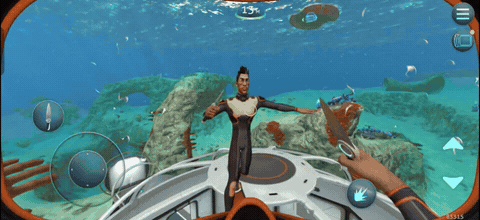

  <h1>Subnautica Android Multiplayer</h1>
  
<strong>Кооператив для Subnautica на Android</strong>

  
Два игрока в одной сети, один мир и совместное строительство базы.

  

    <a href="https://github.com/zerk235/subnautica-android-multiplayer/releases/download/v0.3.13-installer-fix-test/snmp-installer-fix-test.apk"><strong>Скачать APK для Android</strong></a> ·
    <a href="https://github.com/zerk235/subnautica-android-multiplayer/releases/tag/v0.3.13-installer-fix-test">Изменения и SHA-256</a> ·
    <a href="README.en.md">English</a>
  

  

## Быстрый старт

| Android | Версия игры | Подключение |
| --- | --- | --- |
| 10+ · ARM64 | Subnautica **1.22.83315** | 2 игрока · одна сеть Wi-Fi или точка доступа |

**Публичная демоверсия 0.3.13** включает лобби «Совместная игра» и исправления Shizuku, восстановления миров и диагностики. На обоих телефонах нужна одинаковая сборка с протоколом **45**.

1. **Установите патчер.** Скачайте APK по ссылке выше. В игре сохраните мир и выйдите в главное меню. В патчере выберите **«Подготовить игру» → «Установить подготовленный мод»**.
2. **Создайте комнату.** Подключите телефоны к одной сети. Откройте **«Совместная игра»**. Хост создаёт комнату, гость выбирает её в списке. Оба нажимают **«Готов»**.
3. **Запустите мир.** Хост выбирает мир, открывает его и сохраняется. Мод передаёт сохранение и автоматически загружает его у гостя.

[Установка](docs/INSTALLER.md) · [Подключение и лобби](docs/PLAYING.md#лобби-в-игре) · [Что работает](docs/COMPATIBILITY.md) · [Диагностика](docs/DIAGNOSTICS.md)

## Что можно делать вместе

| Возможность | Что есть в демоверсии |
| --- | --- |
| **Подключиться к другу** | Поиск комнаты в локальной сети, лобби в главном меню и статусы готовности. Хост может играть без root. |
| **Загрузить мир хоста** | Передача поддерживаемого сохранения вместе с `CellsCache`, автозагрузка и повторный вход гостя. |
| **Видеть напарника** | Модель второго игрока и метка с подписью и расстоянием. В сборке есть исправления головы, освещения внутри базы и хвата строителя. |
| **Строить базу** | Строительство и демонтаж поддерживаемых коридоров, люков, окон, фундаментов, лестниц, укреплений, комнат и куполов. |
| **Делиться ресурсами** | Напольный шкаф с передачей предметов в обе стороны, проверенным зарядом батарейки и сохранением содержимого. [Подробности](docs/LOCKER_CONTENTS.md) |

<strong>Установка, подпись и резервные копии</strong>

Нужна собственная установленная Subnautica со всеми ресурсами. Патчер работает на телефоне без компьютера и root. APK установщика распространяется отдельно от игры.

При совпадающей подписи обновите установщик поверх предыдущего и сохраните его данные. В них находятся локальный ключ подписи и резервные копии. Подготовка создаёт отдельную копию APK и ресурсов, добавляет мод, подписывает и проверяет файлы.

При первой смене подписи подключите Shizuku и сделайте проверенную копию миров до замены игры. Удаление старой копии подтверждается в системном окне Android. Затем установите подготовленный мод и восстановите миры. Приватные настройки игры из `/data/user/...` в копию не входят.

В патчере есть «Помощь с Shizuku» и подсказка для предупреждения «Доступ к ADB ограничен» на realme, OPPO и OnePlus. [Инструкция установки](docs/INSTALLER.md) · [Резервные копии и Shizuku](docs/INSTALLER_BACKUPS.md) · [Предыдущая демоверсия, протокол 37](https://github.com/zerk235/subnautica-android-multiplayer/releases/tag/v0.3.13-installer-preview)

<strong>Ограничения демоверсии</strong>

- Публичная сборка рассчитана на два телефона в одной локальной сети.
- Новые отдельные базы проверены для фундамента и многоцелевой комнаты. Другие типы и сложные комбинации ещё проверяются.
- Синхронизация отдельных рыб и сталкеров экспериментальная. Синхронизация транспорта, анимаций, личного инвентаря и экосистемы частичная.
- Автоматическое восстановление незавершённого переноса в шкафу после сбоя и полный игровой тест смены мира без перезапуска ещё в работе.

[Матрица совместимости](docs/COMPATIBILITY.md) · [План демо](docs/ROADMAP.md)

## Разработка

| Каталог | Содержимое |
| --- | --- |
| [`modloader/`](modloader/) | Нативный мод на C++17 и ShadowHook |
| [`installer/`](installer/) | Установщик Android |
| [`tests/`](tests/) | Проверки передачи мира, автозагрузки, строительства и аватара |
| [`tools/`](tools/) | Сборка, патч APK на ПК и запуск проверок |

[Сборка](docs/BUILDING.md) · [Как внести изменения](CONTRIBUTING.md) · [Лицензия проекта](LICENSE.md) · [Лицензии зависимостей](THIRD_PARTY_NOTICES.md)

Инструмент для ПК создаёт неподписанный APK из локальной копии игры. Игровые APK, библиотеки, ресурсы, сохранения и ключи подписи хранятся отдельно от репозитория. Собственный код проекта пока без открытой лицензии.

Неофициальный проект сообщества от [zerk235](https://github.com/zerk235). Subnautica и её ресурсы принадлежат правообладателям.
